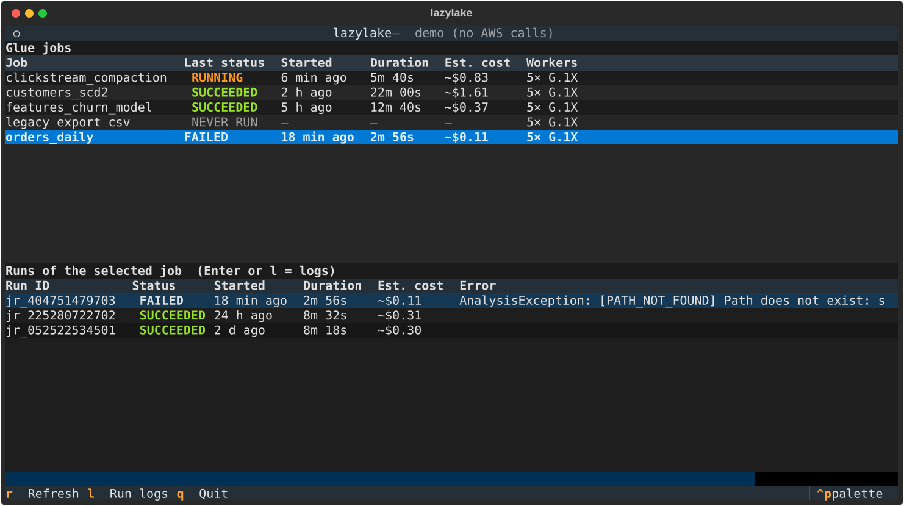
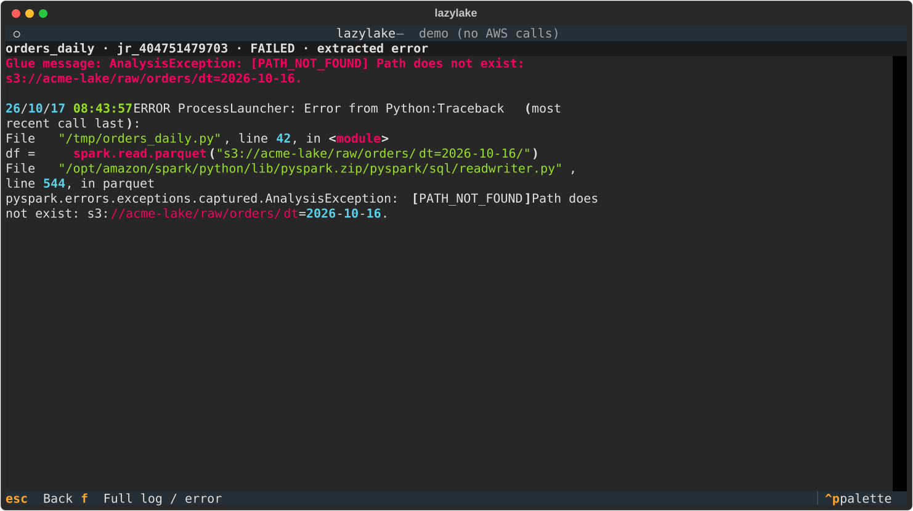

# 🏞️ lazylake

**The terminal browser for your AWS data pipelines.**

A Glue job crashed at 3 a.m.? Without lazylake, you go through the Glue console, find the
run, open CloudWatch, hunt for the right log group and log stream, then scroll through
2,000 lines of Spark logs. With lazylake, you run `lazylake`, move down to the red job and
press `l`: the useful error is displayed, without the noise.

```
┌ lazylake — aws:prod / eu-west-1 ─────────────────────────────────────────────┐
│ Glue jobs                                                                     │
│ Job                     Last status  Started      Duration  Est. cost         │
│ clickstream_compaction  RUNNING      6 min ago    5m 40s    ~$0.83            │
│ customers_scd2          SUCCEEDED    2 h ago      22m 00s   ~$1.61            │
│ orders_daily            FAILED       18 min ago   2m 56s    ~$0.11            │
│ Runs of the selected job  (Enter or l = logs)                                 │
│ jr_…03  FAILED  18 min ago  AnalysisException: [PATH_NOT_FOUND] …             │
└ r Refresh  l Run logs  q Quit ────────────────────────────────────────────────┘
```




## Features (v0.1)

- **Glue jobs**: all your jobs, with their last status, duration and an **estimated cost** in $.
- **Run history** of the selected job.
- **Smart logs**: the Spark/Python error is extracted automatically, and `f` toggles
  to the full log.
- **Demo mode** (`--demo`) to try the tool without an AWS account.
- Works with **AWS SSO** and multiple profiles, because the tool uses the standard AWS
  configuration. lazylake stores no secrets.

## Installation

```bash
# recommended: uv (ultra-fast Python package manager)
uv tool install git+https://github.com/<you>/lazylake

# or pipx
pipx install git+https://github.com/<you>/lazylake
```

## Usage

```bash
lazylake --demo                      # try it without AWS
aws sso login --profile prod         # if you use SSO
lazylake --profile prod --region eu-west-1
```

| Key | Action |
|---|---|
| `↑` `↓` | Navigate |
| `Tab` | Switch between the jobs table and the runs table |
| `Enter` / `l` | Open the logs of the selected run |
| `f` | (in the logs) toggle extracted error / full log |
| `r` | Refresh |
| `Esc` / `q` | Back / quit |

**Estimated cost**: DPU-hours multiplied by the DPU-hour price, $0.44 by default. The price
varies by region; you can adjust it with `export LAZYLAKE_GLUE_DPU_HOUR_PRICE=0.48`.
It is a ballpark figure, not your bill.

**Required IAM permissions** (read-only): `glue:GetJobs`, `glue:GetJobRuns` and
`logs:GetLogEvents` on `/aws-glue/jobs/*`.

## Roadmap

- [ ] Glue Data Catalog: databases, tables, schemas, partitions
- [ ] Local preview of an S3 file (Parquet/CSV/JSON) with DuckDB
- [ ] Athena: cost (data scanned) before and after each query, with opening in Harlequin
- [ ] Step Functions and MWAA (Airflow): status, rerun, backfill
- [ ] SageMaker: endpoints, cost/hour, "forgotten endpoint" alert
- [ ] Iceberg: snapshots and maintenance status
- [ ] Runbooks: your in-house scripts declared in YAML

## Contributing

The architecture is designed for it: each AWS service is an independent **provider**
(see `src/lazylake/providers/`). To add a service, you write a class; the interface
does not change.

```bash
git clone https://github.com/<you>/lazylake && cd lazylake
uv venv && source .venv/bin/activate
uv pip install -e ".[dev]"
pytest                 # tests, including an in-memory fake AWS (moto)
textual run --dev src/lazylake/__main__.py --demo   # dev mode with live style reloading
```

See [CONTRIBUTING.md](CONTRIBUTING.md). New to this ecosystem?
[docs/GLOSSARY.md](docs/GLOSSARY.md) explains every term.

## License

MIT
